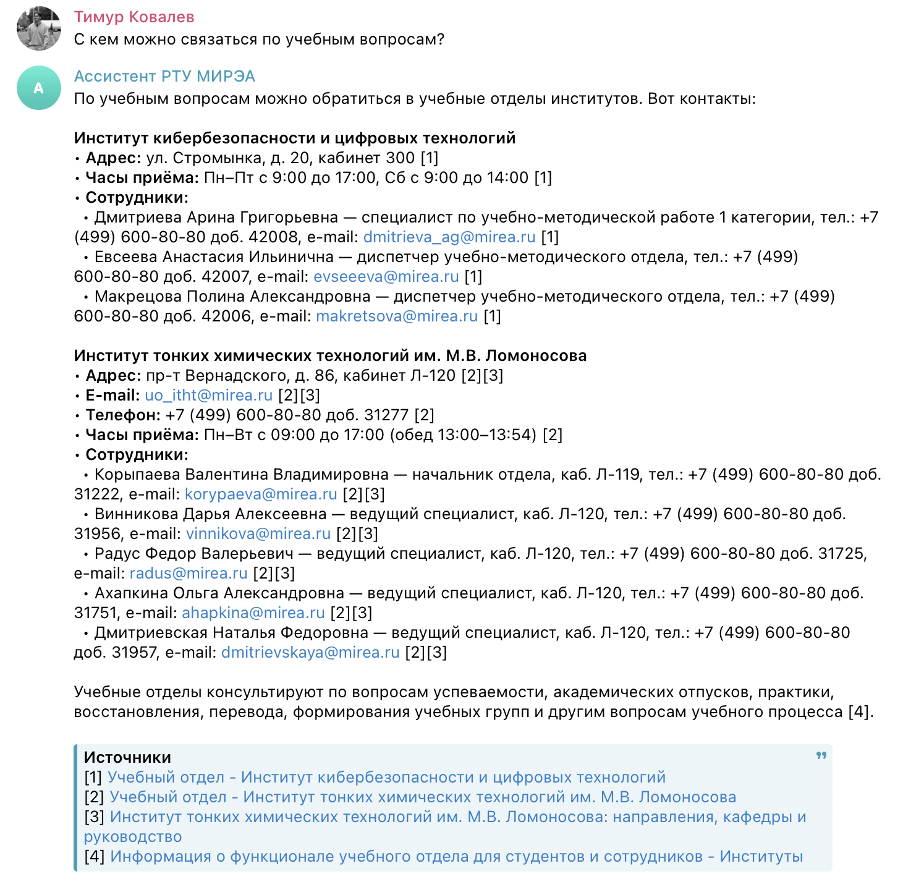
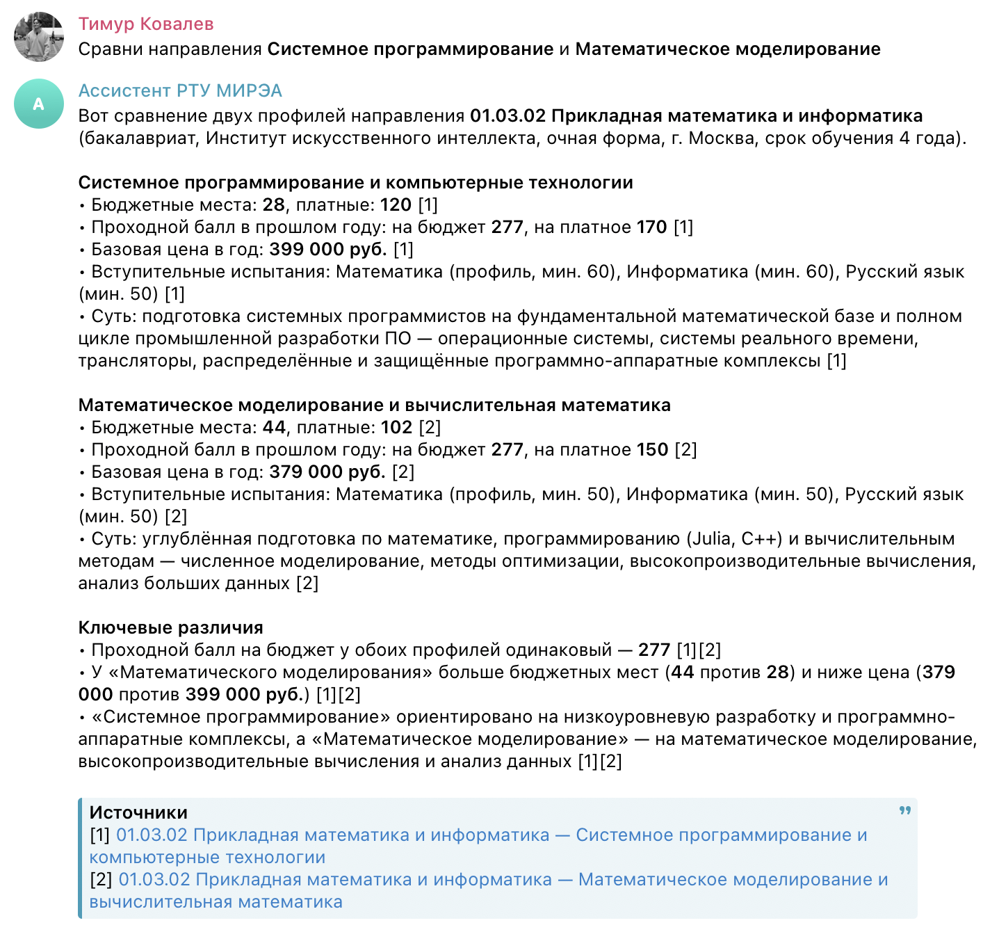
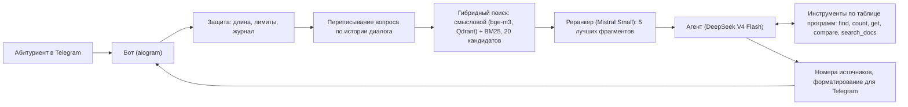

# Ассистент для абитуриентов РТУ МИРЭА

Telegram-бот, который отвечает на вопросы о поступлении в РТУ МИРЭА по материалам сайта приёмной комиссии ([priem.mirea.ru](https://priem.mirea.ru)) и другим разделам института ([mirea.ru](https://www.mirea.ru/education/the-institutes-and-faculties/)).

Проект сделан с нуля, без RAG-фреймворков: сбор данных, нарезка, гибридный поиск, реранкер, агент с инструментами, оценка качества и деплой. 
Сервис развёрнут и работает на инфраструктуре РТУ МИРЭА с локальным инференсом на выделенных **20 ГБ NVIDIA H100**. На GPU-сервере Qwen3-8B-AWQ через vLLM генерирует ответы и ранжирует найденные фрагменты. Бот, эмбеддинги и поиск работают на Linux-VM вуза. [Инструкция по запуску](deploy/CAMPUS.md).
Каждое решение (нарезка, веса поиска, реранкер, модель, число источников, агент, векторная база) выбрано по замерам на собственном наборе вопросов. Все эксперименты и цифры собраны ниже и подробнее в [eval/Эксперименты_модели.md](eval/Эксперименты_модели.md).

## Содержание

- [Что умеет](#что-умеет)
- [Результаты](#результаты)
- [Архитектура](#архитектура)
- [Данные](#данные)
- [Эксперименты](#эксперименты)
- [Структура репозитория](#структура-репозитория)
- [Быстрый старт](#быстрый-старт)
- [Деплой](#деплой)
  - [Кампусный деплой на NVIDIA H100](#кампусный-деплой-на-nvidia-h100)
- [Оценка качества](#оценка-качества)
- [Ограничения](#ограничения)
- [Планы](#планы)

## Что умеет

- **Отвечает по тексту сайтов:** правила приёма, сроки, внутренние экзамены, квоты, индивидуальные достижения, платное и целевое обучение, филиалы, колледжи, расписания, контакты и руководство институтов.
- **Считает по таблице программ** (197 программ приёма 2026 года): сравнение программ, подробная информация о каджой из них. Для этого у модели есть инструменты, числа считает код, а не языковая модель.
- **Помнит диалог:** уточняющие вопросы превращаются в самостоятельные запросы.
- **Ссылается на источники:** в ответе нумерованные ссылки.
- **Не выдумывает и не выходит за тему:** на вопросы без ответа в базе (другой вуз, будущий год, несуществующая программа) отказывает; не играет роли и не раскрывает инструкции.
- **Защищена от злоупотреблений:** лимит длины вопроса, лимиты по минутам и дням, журнал всех запросов.
- **Трассируется в Langfuse**: дерево шагов каждого вопроса, токены, время, стоимость.

## Результаты

Приведённые ниже метрики качества и скорости относятся к конфигурации с внешним API. Для кампусной конфигурации замеры выполняются отдельно.

Все цифры получены на собственных наборах вопросов с эталонами (242 вопроса), ответы оценивает модель-судья по шкале 0–2 (2 верно, 1 частично, 0 неверно). Подробности, оговорки и все таблицы в [отчёте](eval/Эксперименты_модели.md).

| Проверка | Вопросов | Верных ответов | Средний балл (из 2) |
| --- | ---: | ---: | ---: |
| **Контрольный набор вслепую** (новые вопросы, не использовались при настройке) | 45 | **98%** (44 из 45, неверных нет) | 1,98 |
| Основной набор, весь | 197 | 95% | 1,91 |
| из них обычные вопросы | 159 | 96% | 1,94 |
| из них подсчёты, фильтры, перечни | 22 | 91% (без агента было 50%) | 1,82 |
| из них вопросы без ответа в базе (отказ) | 16 | 100% после исправления промпта | |

- На контрольном наборе все 6 вопросов без ответа (в том числе просьба раскрыть промпт) отклонены
- Поиск без реранкера на 186 обычных вопросах: R@1 0,58, R@5 0,89, R@10 0,95, MRR 0,70. С реранкером нужный фрагмент в пятёрке у 93–100% вопросов на разных наборах.
- Время ответа около 12 секунд на вопрос, стоимость порядка 2 копеек (DeepSeek V4 Flash и Mistral Small).

## Демо

Работа бота в Telegram.

**Контакты:** ответ собран из сводок и страниц институтов (адреса, часы приёма, телефоны, e-mail сотрудников). Номера в тексте ведут в сворачиваемый блок «Источники» с кликабельными названиями страниц.



**Сравнение программ:** два профиля направления 01.03.02 по местам, проходным баллам, цене, вступительным испытаниям и содержанию, с итоговыми различиями.




## Архитектура



1. **Защита.** Вопрос длиннее 500 символов отклоняется; на пользователя действуют лимиты 5 вопросов в минуту и 100 в день, общий потолок 2000 в день. Каждый запрос пишется в журнал `logs/qa.jsonl`.
2. **Переписывание.** Если в диалоге есть история (до трёх последних обменов), уточняющий вопрос превращается в самостоятельный: подставляются программа, уровень образования, год; короткое «да» становится просьбой выполнить предложение ассистента.
3. **Гибридный поиск.** Смысловой поиск (эмбеддинги `baai/bge-m3`, хранятся в Qdrant) и BM25 по тем же фрагментам. Оценки обоих нормируются и складываются: `0,6 · смысловой + 0,4 · BM25`. Смысловой поиск ошибается на точных кодах программ (09.03.04), BM25 на синонимах, вместе они покрывают оба случая.
4. **Реранкер.** Языковая модель (Mistral Small) читает 20 кандидатов (по 1000 символов) и выбирает 5, содержащих саму информацию, а не просто похожую тему.
5. **Агент.** DeepSeek V4 Flash получает 5 источников и описание инструментов. Поиск по текстам выполняется всегда, поэтому агент не отвечает без источников; на вопросы про количество, максимум, списки по условию он вызывает инструменты. При сбое бот отвечает обычным способом по найденным фрагментам.
6. **Инструменты.** `find_programs` (отбор по условиям и сортировка), `count_programs` (подсчёт программ или направлений с группировкой), `get_program` (карточка), `compare_programs` (сравнение 2–5 программ), `search_docs` (поиск по текстам). Аргументы описаны моделями pydantic, схемы строятся из них, ошибки валидации возвращаются модели текстом, чтобы она исправила вызов.
7. **Ответ.** Номера ссылок перенумеровываются по порядку первого упоминания, источники склеиваются по страницам (одна страница это одна ссылка), текст оформляется для Telegram (HTML, жирный шрифт, сворачиваемый блок источников).

### Технологии

| Задача | Что используется |
| --- | --- |
| Язык | Python 3.12 |
| Эмбеддинги | `baai/bge-m3` через API или локальная `bge-m3` через Ollama |
| Векторная база | Qdrant |
| Поиск по словам | `rank-bm25`, стемминг `PyStemmer` |
| Модель ответа | DeepSeek V4 Flash через провайдера или Qwen3-8B-AWQ через vLLM |
| Судья в опубликованных экспериментах | DeepSeek V4 Flash |
| Реранкер | Mistral Small 24B через провайдера или Qwen3-8B-AWQ в кампусной конфигурации |
| Доступ к моделям | OpenAI-совместимый интерфейс, отдельные адреса генерации и эмбеддингов в кампусной конфигурации |
| Инструменты агента | tool calling, схемы и валидация на `pydantic` |
| Telegram | `aiogram` 3 |
| Мониторинг | Langfuse по настройке, выключен в кампусном Compose |
| Сбор данных | `httpx`, `beautifulsoup4`, `trafilatura` |
| Запуск | Docker Compose |
| Тесты и CI | `pytest`, GitHub Actions |

## Данные

| Источник | Что взято | Результат |
| --- | --- | --- |
| priem.mirea.ru | страницы разделов (бакалавриат и специалитет, магистратура, аспирантура, СПО, филиалы, об университете), страницы 197 программ из JSON API, итоги приёма по годам | 312 страниц и 7 сводок, 4476 фрагментов |
| mirea.ru, «Институты и факультеты» | 7 институтов: структура и кафедры, программы, руководство, контакты | 296 страниц и 10 сводок, 1292 фрагмента |

Всего **5768 фрагментов**. Дополнительно из страниц программ собрана таблица (`index/programs.json`): места, цены, проходные баллы по годам, вступительные испытания, срок, институт, описание.

Парсер ([parser.py](parser.py)) обходит сайты с учётом `robots.txt` и ограничений скорости (повторы при ошибке 429 с учётом `Retry-After`), вырезает повторяющиеся блоки навигации и сохраняет страницы в Markdown. Сводки по институтам (перечень институтов, направления, кафедры, страница по каждому институту) собирает [institutes_summary.py](institutes_summary.py): без них перечисления вроде «какие институты есть» не находились, потому что список лежит в меню сайта.

## Эксперименты

Ниже короткие итоги; таблицы, методика и ограничения каждого замера в [отчёте](eval/Эксперименты_модели.md). Метрики поиска: R@k (доля вопросов, у которых правильный фрагмент попал в первые k) и MRR.

### Тестовые наборы

| Набор | Вопросов | Что это |
| --- | ---: | --- |
| v1 | 69 | исходный: факты о программах, правила, подсчёты и фильтры, сравнения, уточняющие вопросы, вопросы без ответа |
| v2 | 29 | добавлены позже: новые страницы, провокации, вопросы вне базы |
| para | 80 | по две перефразировки каждого из 40 обычных вопросов (опечатки, сокращения, разговорный стиль) |
| inst | 19 | про институты: руководство, кафедры, контакты, перечни |
| holdout | 45 | контрольный набор вслепую, составлен после всех настроек |

Эталон каждого вопроса проверяется кодом: цитата-доказательство (`evidence`) должна быть найдена в исходном файле, а числа в ответе посчитаны по данным.

### 1. Нарезка, способ поиска, вес α

- **Способ поиска** (R@1 / R@5 / R@10 / MRR): смысловой 0,47 / 0,78 / 0,85 / 0,60; BM25 0,40 / 0,75 / 0,82 / 0,56; RRF 0,62 / 0,88 / 0,90 / 0,72; **взвешенная сумма 0,65 / 0,90 / 0,97 / 0,76**. Сложная нарезка с дублированием заголовков оказалась хуже простой.
- **Размер фрагмента:** лучшие результаты при максимуме 1200 символов; минимум 250 дал R@5 0,93 против 0,85 без минимума (важнее для RAG, чем R@1).
- **Вес α** (0 только BM25, 1 только смысловой): MRR максимален при 0,6 (0,80), крайние значения заметно хуже (0,56 и 0,60).
- **Вывод:** простая нарезка (1200 / 250), гибридный поиск с α = 0,6. Подсчёты и фильтры по нескольким страницам поиск не решает вообще (R@10 на подсчётах 0,25, на фильтрах 0,00): для этого нужен структурный поиск, то есть агент с инструментами.

### 2. Реранкер

Схема: поиск берёт 20 кандидатов, модель выбирает 5. Параметр `SNIPPET`, сколько символов фрагмента видит реранкер, оказался критичным:

| Вариант | Обычные R@5 | MRR | Агрегации R@5 |
| --- | ---: | ---: | ---: |
| без реранкера | 0,93 | 0,79 | 0,40 |
| Mistral Small, 400 символов | 0,82 | 0,66 | 0,60 |
| **Mistral Small, 1000 символов** | **1,00** | **0,85** | 0,60 |

При 400 символах реранкер не видел числа и условия в хвосте фрагмента и ухудшал поиск. Сравнивались ещё три дешёвые модели, все 1000 символов:

| Модель реранкера | Обычные R@1 / R@5 / MRR | Секунд на прогон |
| --- | --- | ---: |
| **Mistral Small** | **0,75 / 1,00 / 0,85** | **218** |
| Llama 3.1 8B | 0,68 / 0,88 / 0,75 | 202 |
| Qwen 3.5 9B | 0,60 / 1,00 / 0,77 | 484 |
| Mistral Nemo | 0,55 / 0,95 / 0,71 | 420 |

**Выбор:** Mistral Small. Проверка на расширенном наборе подтвердила выигрыш: на новых вопросах R@5 0,67 → 0,95, на перефразировках 0,90 → 0,94.

### 3. Оценка судьёй: проверка самого судьи

Судья (модель) проверен вручную: прочитаны все 14 вопросов без ответа и 21 обычный вопрос с оценкой 0 или 1. Все 14 отказов оценены верно; около половины низких оценок на обычных вопросах были занижены (судья наказывал за лишнюю информацию). Промпт судьи исправлен правками (лишнее не снижает оценку, оценивать только то, о чём спросили, не придираться к году и т. д.), доля верных на обычных вопросах выросла с 86% до 91%, на вопросах без ответа судье сообщается их тип.

### 4. Рассуждения, число источников, модель ответа

- **Рассуждения модели** (thinking): качество то же (1,79 против 1,78 из 2), но в 2 раза медленнее и в 8 раз больше токенов на выходе, плюс сбои (пустые ответы). **Выключены.**
- **Число источников K** (3, 5, 8, 12): в пределах шума, ни одно значение не лучше. **K = 5.**
- **Модель ответа** (одни и те же 178 вопросов):

| Модель | Обычные верных | Агрегации верных | Стоимость за прогон, ₽ |
| --- | ---: | ---: | ---: |
| **DeepSeek V4 Flash** | 91% | 47% | **0,8** |
| DeepSeek V4.1 Flash | 92% | 47% | 10,3 |
| GPT-6 Luna | 91% | 41% | 6 |
| Mistral Small | 88% | 29% | 2,4 |
| Llama 3.3 70B | 88% | 24% | 7,5 |

Три модели равны по качеству, **выбран DeepSeek V4 Flash**: в 7–13 раз дешевле. Оговорка: судья из того же семейства, но Luna и Llama судья «не узнаёт», и Luna получила оценки на уровне V4 Flash, поэтому серьёзного перекоса нет. Устойчивые ошибки (подсчёты и фильтры) не зависят от модели: это ограничение поиска, а не языковой модели.

### 5. Добавление раздела «Институты»

Раздел сначала добавлялся в пробный индекс, и результат сравнивался с исходным:

- вопросы про институты: 0% находимых без раздела, на итоговом индексе 100% верных ответов на обычных вопросах (12 из 12), на перечнях 40%;
- на прежних вопросах поиск и ответы не ухудшились (R@5 не изменился ни на одном наборе, оценки ответов в пределах шума);
- сводки по институтам оказались критичными для перечней.

### 6. Агент с инструментами

Подсчёты, фильтры и перечни поиском по текстам не решаются. Агент добавлен в три итерации:

| Группа (117 вопросов) | Без агента | Агент v1 | Агент v2 | Агент v3 |
| --- | ---: | ---: | ---: | ---: |
| Обычные (79) | 96% | 90% | 97% | 91% |
| Агрегации (22) | 50% | 73% | 73% | **82%** |
| Без ответа (16) | 100% | 100% | 100% | 100% |

- **v1:** агент часто отвечал по памяти без поиска и без инструментов (обычные вопросы 90%): поиск по текстам теперь выполняется всегда.
- **v2:** исправлены пробелы в инструментах (проходной на платное, срок в месяцах, программы против направлений).
- **v3:** в сообщение добавлено напоминание вызывать инструменты на вопросах про количество и списки.

Итог на всех 197 вопросах: агрегации 50% → 91%, обычные 94% → 96%, время на вопрос не выросло (около 12–13 секунд).  
Инструменты для институтов (`get_institute`, `find_departments`) были проверены и **убраны**: из 17 вопросов их вызвали в одном, остальные решались поиском и сводками.

### 7. Векторная база: Qdrant вместо numpy

Раньше векторы лежали в файле и считались через numpy. Qdrant проверен на 175 вопросах как отдельный бэкенд, поиск без реранкера (R@1 / R@5 / R@20 / MRR на обычных вопросах):

| Вариант | Обычные | Время поиска |
| --- | --- | ---: |
| numpy (прежний) | 0,56 / 0,88 / 0,99 / 0,69 | 7 мс |
| Qdrant, смысловой поиск + наши BM25 и слияние | 0,56 / 0,88 / 0,99 / 0,69 | 50 мс |
| Qdrant, встроенное слияние RRF | 0,54 / 0,82 / 0,97 / 0,66 | 98 мс |
| Qdrant, встроенное слияние DBSF | 0,52 / 0,84 / 0,98 / 0,65 | 99 мс |

Результаты поиска у numpy и Qdrant с нашим слиянием совпали для всех 175 вопросов. Встроенные способы слияния Qdrant хуже нашей взвешенной суммы (особенно по R@20, важному для реранкера). **Переход на Qdrant** оправдан не качеством и скоростью, а удобством: фильтры по метаданным в запросе (например, по уровню образования), хранение вектора вместе с фрагментом и общий сервис для нескольких процессов. Первый прогон встроенных режимов дал сильно заниженные результаты из-за ошибки в BM25-векторах (порядок слов зависел от запуска Python); ошибка найдена, исправлена и описана в отчёте.

### 8. LlamaIndex и LangGraph (проверены, не взяты)

Обе библиотеки пробовались отдельными версиями на тех же данных и вопросах, чтобы сравнить с собственной реализацией; код и окружения после сравнения удалены, результаты сохранены в отчёте.

- **LlamaIndex** (смысловой поиск, `BM25Retriever`, `QueryFusionRetriever`, `LLMRerank`): из коробки хуже по R@5 на обычных вопросах (0,86 и 0,81 против 0,88) и заметно хуже по R@20 на подсчётах (0,55 против 0,77). Диагностика показала: смысловая часть совпадает с нашей полностью (пересечение топ-10 равно 10 из 10), расхождение даёт BM25 из библиотеки `bm25s` (пересечение 6,1 из 10) и глубина кандидатов по умолчанию. С нашим BM25 и полной глубиной LlamaIndex повторяет наш поиск (0,56 / 0,88 / 0,99). Вывод: каркас не мешает, но готовые компоненты нужно проверять на своих данных; предметная часть (агент, таблица, склейка источников) в нём не реализуется готовыми блоками.
- **LangGraph** (цикл агента как граф `rewrite → retrieve → agent ⇄ tools → finish`, модель через LangChain): те же 95% верных на 197 вопросах, время 12,8 секунды против 12,7 у нашего агента. Различия отдельных вопросов в пределах шума, часть улучшений объясняется более поздним промптом. Вывод: для линейного агента цикл на 40 строк эквивалентен графу; LangGraph имеет смысл, когда нужны ветвления, пауза с вопросом пользователю или сохранение состояния диалога.

### 9. Мониторинг

LangSmith не использовался: он привязан к экосистеме LangChain, данные уходят во внешний сервис. Выбран **Langfuse**: открытый, подключается к любому коду (обёртка над клиентом `openai` и декоратор `@observe`). Локальный стенд из шести контейнеров поднимался для проверки, но на сервере с 2 ГБ памяти он не помещается, поэтому используется Langfuse Cloud. Накладные расходы: около 0,7 мс на шаг, отправка в фоновом потоке.

### 10. Контрольный набор вслепую

45 новых вопросов составлены после всех настроек: 12 случайных программ из 163, по которым раньше вопросов не было, 18 вопросов по ранее не использовавшимся страницам правил, 3 подсчёта, 3 вопроса про кафедры, 6 вопросов без ответа, 3 уточняющих. Промпты и код после прогона не менялись.

| Группа | Вопросов | Верных | Неверных |
| --- | ---: | ---: | ---: |
| обычные | 36 | 97% | 0% |
| подсчёты и фильтры | 3 | 100% | 0% |
| без ответа | 6 | 100% | 0% |
| **все** | **45** | **98%** | **0%** |

## Стоимость и ресурсы

### Один вопрос (агент, DeepSeek V4 Flash и Mistral Small)

| Показатель | Значение |
| --- | --- |
| Входных токенов | около 13–14 тысяч |
| из них у реранкера | около 5 тысяч |
| Выходных токенов | около 150–210 |
| Вызовов модели | реранкер 1, агент от 1 до 5, переписывание вопроса при наличии истории диалога |
| Время ответа | около 15 секунд |
| Стоимость | порядка 20 копеек |

- **Рассуждения выключены:** ответ в 2 раза быстрее, выходных токенов в 8 раз меньше (26 тысяч против 208 тысяч за прогон).
- **Защита бюджета:** лимиты 5 вопросов в минуту и 100 в день на пользователя, общий потолок 2000 в день, поэтому расход в сутки ограничен.
- **Эмбеддинги** платные только при сборке индекса; готовый индекс лежит в репозитории, на запрос тратится один короткий вызов эмбеддинга вопроса.

### Ресурсы конфигурации с внешним API

| Показатель | Значение |
| --- | --- |
| Память процесса бота | около 0,5 ГБ |
| Старт поиска | около 2,4 секунды |
| Поиск | около 50 мс (смысловой в Qdrant плюс BM25), на фоне вызовов моделей несущественно |
| Сервер | VPS с 2 ГБ оперативной памяти: бот и Qdrant в Docker Compose |
| Данные на диске | индекс 33 МБ, таблица программ 1,7 МБ, собранные страницы 8,7 МБ |
| Размер репозитория | около 27 МБ в git |
| Трассировка Langfuse | около 0,7 мс на шаг, отправка в фоновом потоке |
| Полный прогон оценки | 197 вопросов за 11 минут (4 вопроса параллельно), контрольный набор из 45 вопросов за 144 секунды |
| Тесты | 67 тестов за 0,2 секунды |

## Структура репозитория

```
rag/
  ask.py              конвейер ответа: переписывание вопроса, поиск, реранкер, агент, запасной режим
  agent.py            агент: промпт, цикл вызовов инструментов, откат при сбое
  tools.py            инструменты по таблице программ, схемы и валидация (pydantic)
  programs.py         разбор страниц программ в таблицу, модель Program
  search.py           гибридный поиск: Qdrant (смысловой) + BM25, слияние
  qdrant_store.py     загрузка индекса в Qdrant, подключение (локально или сервер)
  rerank.py           реранкер на языковой модели
  chunking.py         нарезка страниц на фрагменты
  embed.py            эмбеддинги через API
  index.py            сборка индекса (векторы и фрагменты)
  institutes.py       разбор страниц институтов
  llm.py              клиент модели (OpenAI-совместимый API)
  guard.py            лимиты и журнал запросов
  bot.py              Telegram-бот
  telegram_format.py  оформление ответа для Telegram
  tracing.py          необязательная трассировка в Langfuse
parser.py             парсер сайтов
institutes_summary.py сводки по институтам из сохранённых страниц
data/                 собранные страницы (priem и institutes)
index/                готовый индекс (index/api) и таблица программ (programs.json)
eval/                 наборы вопросов, скрипты оценки, результаты, отчёт с экспериментами
tests/                тесты pytest
.github/workflows/    CI
```

## Быстрый старт

Для запуска на GPU вуза перейдите к [кампусному деплою](#кампусный-деплой-на-nvidia-h100). Для запуска с внешним провайдером нужны Python 3.12, ключ OpenAI-совместимого API (в проекте используется [polza.ai](https://polza.ai), адрес задаётся в `rag/llm.py` по умолчанию) и, для бота, токен Telegram-бота.

```bash
git clone https://github.com/TimurKov1/MIREA-RAG.git
cd MIREA-RAG
python -m venv .venv && source .venv/bin/activate
pip install -e .

export LLM_API_KEY=...          # ключ API моделей
export TELEGRAM_TOKEN=...       # нужен только для бота

python -m rag.qdrant_store      # загрузить готовый индекс в локальное хранилище Qdrant (платить за эмбеддинги не нужно)
python -m rag.ask "сколько программ магистратуры принимает РТУ МИРЭА?"
python -m rag.bot               # запустить Telegram-бота
```

Готовые данные и индекс лежат в репозитории, поэтому сборка с нуля не обязательна. Локальный режим Qdrant открывает хранилище одним процессом: бот и скрипты оценки одновременно запускать нельзя (на сервере Qdrant работает отдельным контейнером).

### Пересобрать данные и индекс

```bash
pip install -e ".[parser]"
python parser.py                    # priem.mirea.ru в data/priem
python parser.py institutes         # раздел институтов в data/institutes
python institutes_summary.py        # сводки по институтам
python -m rag.index                 # полная сборка индекса (эмбеддинги через API, платно)
python -m rag.index --add data/institutes   # добавить папку к индексу, остальное не пересчитывать
python -m rag.qdrant_store          # загрузить индекс в Qdrant
```

### Переменные окружения

| Переменная | Назначение |
| --- | --- |
| `LLM_API_KEY` | ключ API моделей (обязательно) |
| `TELEGRAM_TOKEN` | токен бота (для `rag.bot`) |
| `QDRANT_URL` | адрес сервера Qdrant; без него используется локальное хранилище `index/qdrant` |
| `LANGFUSE_PUBLIC_KEY`, `LANGFUSE_SECRET_KEY`, `LANGFUSE_BASE_URL` | трассировка в Langfuse (необязательно) |

## Деплой

### Кампусный деплой на NVIDIA H100

| Площадка | Сервисы и назначение |
| --- | --- |
| GPU-сервер вуза | vLLM держит Qwen3-8B-AWQ в пределах выделенных 20 ГБ H100. Модель формирует ответы, выбирает инструменты и ранжирует найденные фрагменты. |
| Linux-VM вуза | Docker Compose запускает бота, Qdrant и Ollama с BGE-M3 на CPU. Python-код делает гибридный поиск, проверяет аргументы и выполняет инструменты. |
| Внутренняя сеть | Бот отправляет генерацию на внутренний HTTPS-адрес vLLM, а эмбеддинги — в отдельный контейнер Ollama. |

Стартовый профиль vLLM рассчитан на работу с контекстом до 12 288 токенов и четырьмя активными последовательностями. Для постоянной работы бота GPU и внутренний адрес должны оставаться доступными на протяжении пилота. На GPU-хосте используется выделенное администратором устройство. При запуске через планировщик vLLM стартует внутри выделенного задания.

**Порядок запуска**

1. Запустить vLLM по [инструкции для GPU-сервера](deploy/CAMPUS.md#gpu-сервер) и проверить доступность его `/v1/models` с VM бота.
2. Создать `.env.campus` из `.env.campus.example` и задать внутренний адрес vLLM, ключ сервиса и токен Telegram-бота.
3. Поднять Qdrant и Ollama через `compose.campus.yml`. Пересчитать векторы готовых фрагментов локальной BGE-M3, загрузить их в кампусный Qdrant.
4. Запустить `python -m rag.check_campus` в контейнере бота. Проверка обращается к обоим модельным сервисам и проверяет ответ с источниками и ответ с вызовом инструмента. После успешной проверки запустить Telegram-бота.

Кампусная конфигурация использует отдельные тома для индекса и Qdrant. Трассировка Langfuse и запись диалогов приложением выключены. Telegram остаётся внешним каналом общения. Для оценки кампусной конфигурации используем набор вопросов проекта и p95 времени полного ответа под нагрузкой.

[Полная инструкция для администраторов и разработчиков](deploy/CAMPUS.md)

### Деплой на VPS с внешним API

Бот и Qdrant запускаются Docker Compose; бот ходит к Qdrant по сети контейнеров (`QDRANT_URL=http://qdrant:6333`), журнал запросов сохраняется в `./logs`. Работает на выделенном VPS сервере.

```bash
docker compose build
docker compose up -d qdrant
docker compose run --rm bot python -m rag.qdrant_store    # один раз: загрузить индекс в Qdrant
docker compose up -d
docker compose logs -f bot
```

Файл `.env` (по образцу `.env.example`) читает Docker Compose: на сервере в нём нужны `LLM_API_KEY` и `TELEGRAM_TOKEN`. В образ попадают только `rag/` и `index/`, данные для сборки, оценка и парсер в него не входят.

### Тесты

```bash
pip install -e ".[dev]"
python -m pytest -q
```

67 тестов, которые не требуют сети и ключей: чанкинг, гибридный поиск на временном Qdrant, инструменты агента, цикл агента с подставной моделью, склейка источников и перенумерация ссылок, лимиты и журнал, форматирование для Telegram, реранкер. GitHub Actions запускает `pyflakes` и `pytest` на каждый push и pull request.

## Ограничения

- **Данные приёмной кампании 2026 года.** Они собраны на момент сбора; автоматического обновления нет, после изменений на сайте парсер и индекс нужно пересобирать вручную.
- **Расхождения самих сайтов.** Например, общая страница пишет «более 250 образовательных программ», а в таблице приёма 197; сводки приёмной комиссии и страницы институтов по-разному указывают подразделения направлений. Бот отвечает по найденному и не может примирить два источника.
- **Оценка.** Судья и отвечающая модель из одного семейства (DeepSeek), по одному прогону на конфигурацию; шум между прогонами 3–5 пунктов. Контрольный набор небольшой (45 вопросов).
- **Недетерминизм модели.** Одна и та же конфигурация может дать чуть разные ответы, поэтому выводы делались по крупным различиям и по нескольким наборам.
- **Бот понимает только текст**, не хранит историю диалога между перезапусками и учитывает лимиты в памяти процесса.

## Планы

- Добавление новых страниц
- Документы из PDF и Word (положения, правила приёма) и другие разделы mirea.ru.
- Автоматическое обновление данных и пересборка индекса по расписанию.
- Замеры качества и задержки локального инференса на инфраструктуре вуза
